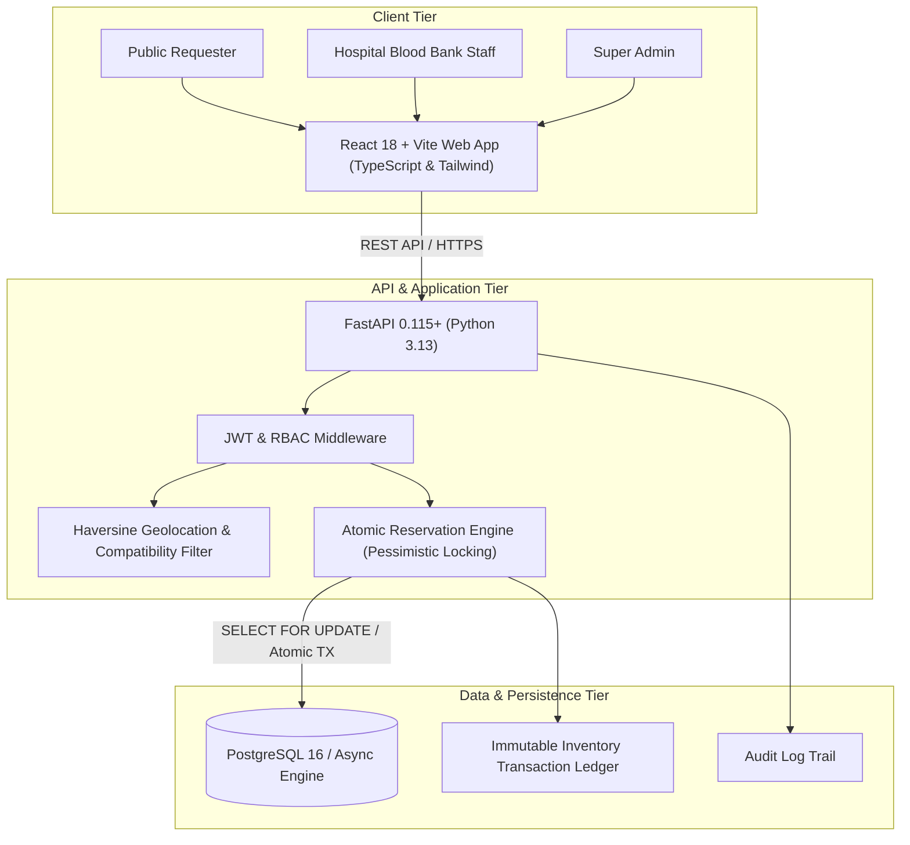
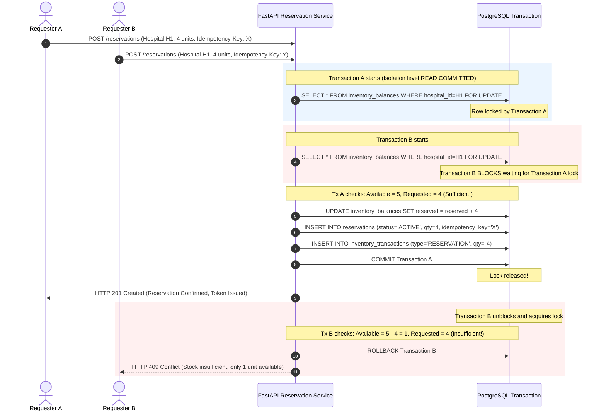

# BloodConnect — System Architecture

## 1. High-Level Architecture Overview

BloodConnect is built as a multi-tier, decoupled architecture designed for high integrity, horizontal scalability, and strict hospital data isolation.



---

## 2. Reservation Concurrency Sequence

The core mission of BloodConnect is guaranteeing that competing blood reservation requests never lead to over-reservation or negative stock.



---

## 3. Hospital Tenant Data Isolation

1. **Authentication Context**: Every authenticated request sets a `CurrentUser` dependency containing user ID, role, and associated `hospital_id`.
2. **Server-Side Enforcement**: Hospital staff endpoints enforce:
   ```python
   if current_user.role == UserRole.HOSPITAL_STAFF and current_user.hospital_id != target_hospital_id:
       raise HTTPException(status_code=403, detail="Access denied to other hospital data")
   ```
3. **Database Scoping**: All inventory queries executed by hospital staff implicitly filter by `hospital_id == current_user.hospital_id`.
