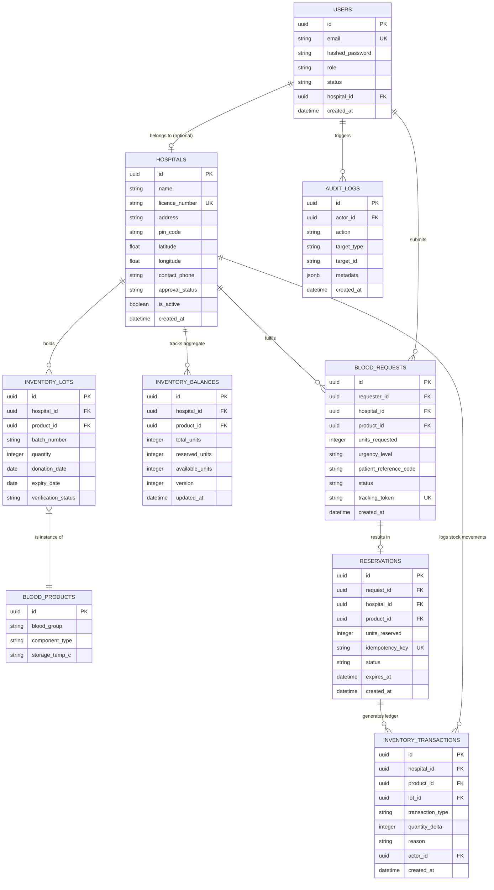

# BloodConnect — Database Design & Schema Specification

## 1. Entity Relationship (ER) Diagram

---

## 2. Inventory Invariants & Constraints

1. **Available Units Formula**:
   $$\text{available\_units} = \text{total\_units} - \text{reserved\_units}$$
   Enforced via `CHECK (available_units >= 0)` and `CHECK (reserved_units >= 0)`.
2. **Deterministic Locking Order**:
   When multiple balances/lots are locked during a reservation, queries lock in ascending ID order (`ORDER BY id ASC`) to eliminate circular wait conditions (deadlocks).
3. **Idempotency Guarantee**:
   `idempotency_key` in `RESERVATIONS` is marked `UNIQUE`. Duplicate submission of the same key returns the existing reservation without duplicate stock deductions.
4. **Immutable Ledger**:
   `INVENTORY_TRANSACTIONS` is append-only. Stock adjustments, incoming donations, expirations, reservations, and cancellations always write a delta entry.
